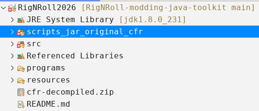
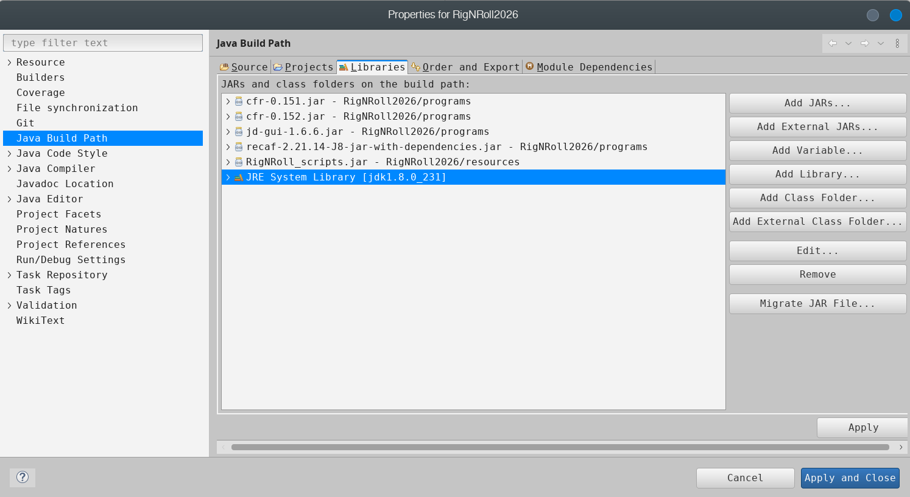
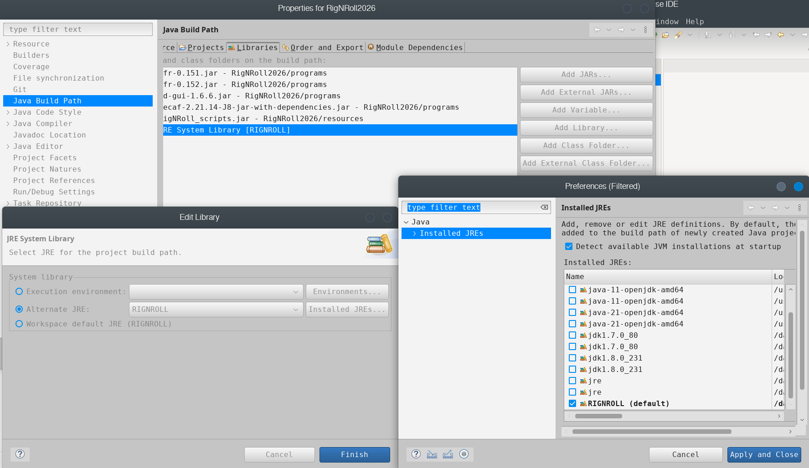
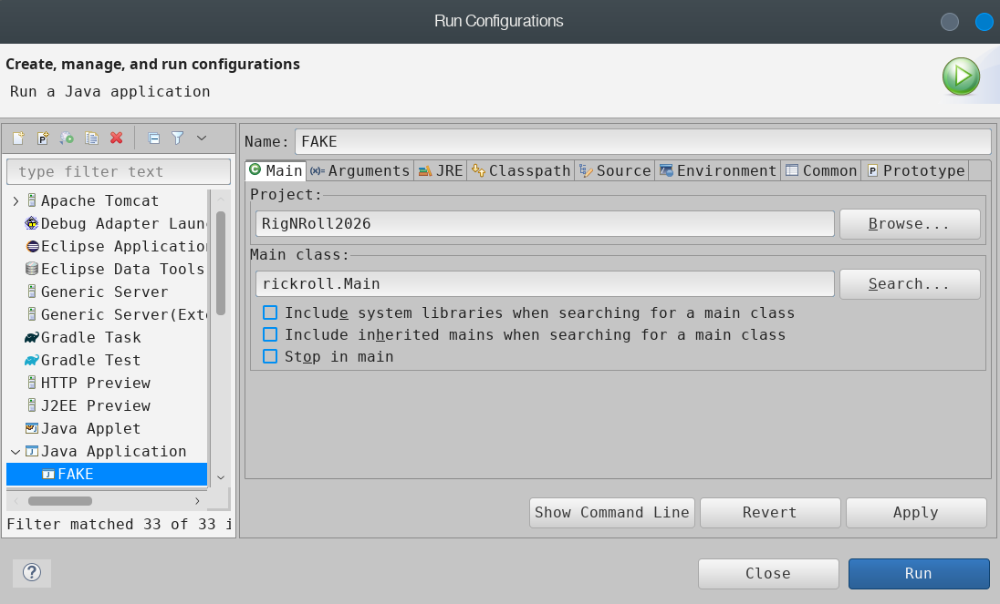
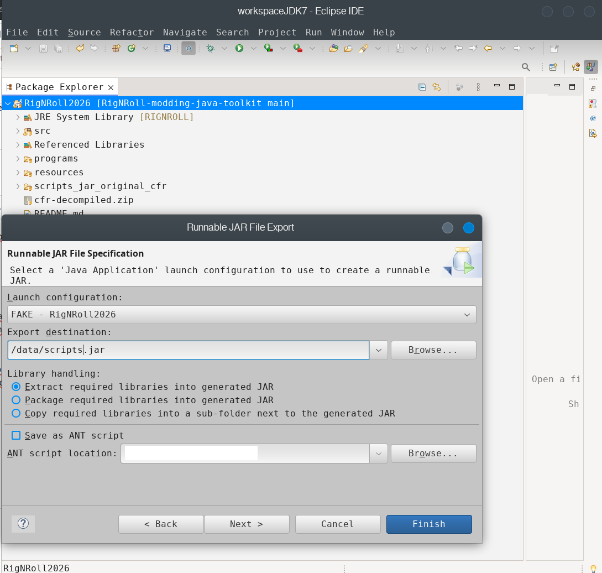
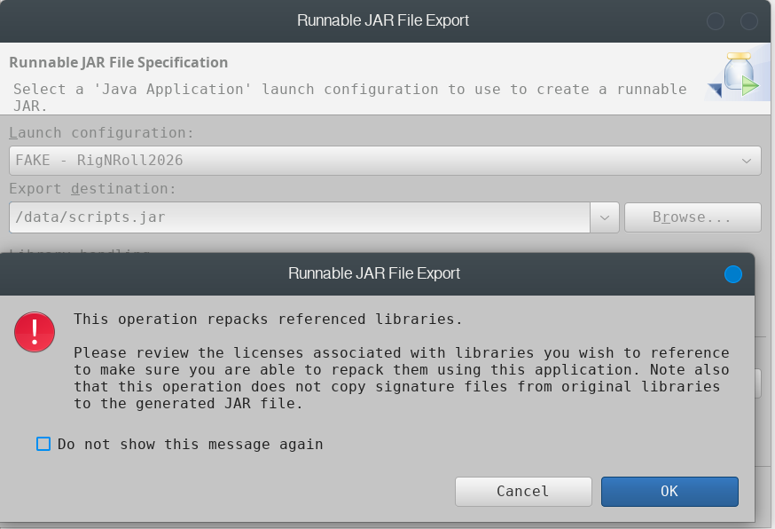

# RigNRoll-modding-java-toolkit

Contains decompiled java classes from RignNRoll scripts.jar file and some new classes ('rickroll' namespace). Java classes with compilation errors or that causes bugs were renamed from .java to .java_broken

Can be used to compile a modified scripts.jar to replace the one in the game directory.

## Build guide

**1) Clone the repository**

```
git clone https://github.com/JosueCA/RigNRoll-modding-java-toolkit.git
```

**2) Create a new Java project in Eclipse pointing to the cloned directory**

Eclipse > File > New > Java Project
- Project Name: `RigNRoll2026`
- Location: `RigNRoll-modding-java-toolkit`



**3) Remove `scripts_jar_original_cfr` from the build path**

Right click on the directory > Build Path > Remove from build path

**4) Set the JRE System Library to Java 1.5**

Right click on project > Properties > Java Build Path > Libraries tab



You can use the JVM bundled with the game: `c/Program Files/1C/RigNRoll/Jvm`



**5) Create a fake Run Configuration**

Run > Run Configurations > Java Application
- Name: `FAKE`
- Project: `RigNRoll2026`
- Main class: `rickroll.Main`



**6) Export the JAR**

Eclipse > File > Export > Java > Runnable JAR file
- Launch Configuration: `FAKE - RigNRoll 2026`
- Accept the "This operation repacks referenced libraries" prompt





The following warnings after export are expected and can be ignored:


```
JAR export finished with warnings. See details for additional information.
Exported with compile warnings: RigNRoll2026/src/adjusting/Variables.java
duplicate entry: org/benf/cfr/reader/api/CfrDriver$Builder.class
```

> **Compilation errors are not OK.** If you see any, make sure `scripts_jar_original_cfr` has been removed from the build path (step 3).

**7) Replace the JAR in the game directory**


